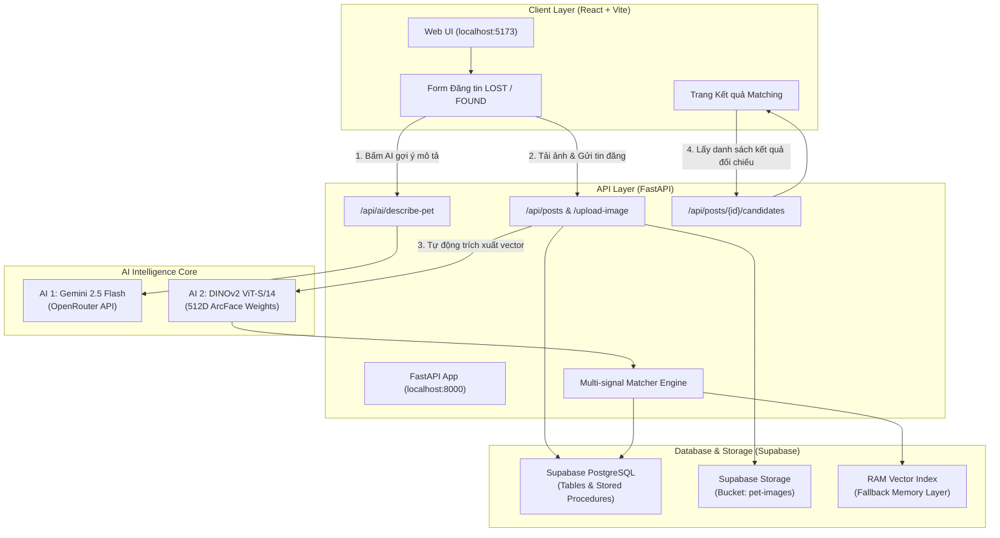

# 🐾 PyPaws — Nền Tảng Hỗ Trợ Tìm Kiếm & Kết Nối Thú Cưng Thất Lạc Bằng AI

<p align="center">
  
</p>

<p align="center">
  <strong>Mỗi dấu chân đều dẫn lối về nhà.</strong><br>
  Ứng dụng trí tuệ nhân tạo (Multimodal AI & Metric Learning) giúp nhận diện, mô tả ngoại hình và đối chiếu khuôn mặt chó mèo thất lạc với tỉ lệ chính xác cao.
</p>

---

## 📑 Mục lục
1. [Giới thiệu tổng quan](#-giới-thiệu-tổng-quan)
2. [Kiến trúc hệ thống](#-kiến-trúc-hệ-thống)
3. [Cấu trúc thư mục](#-cấu-trúc-thư-mục)
4. [Yêu cầu môi trường (Prerequisites)](#-yêu-cầu-môi-trường-prerequisites)
5. [Hướng dẫn cài đặt chi tiết từng bước (Step-by-Step Setup)](#-hướng-dẫn-cài-đặt-chi-tiết-từng-bước)
   - [Bước 1: Clone mã nguồn & Cấu hình biến môi trường](#bước-1-clone-mã-nguồn--cấu-hình-biến-môi-trường)
   - [Bước 2: Cấu hình Cơ sở dữ liệu & Supabase Storage](#bước-2-cấu-hình-cơ-sở-dữ-liệu--supabase-storage)
   - [Bước 3: Chuẩn bị mô hình AI & Trọng số DINOv2](#bước-3-chuẩn-bị-mô-hình-ai--trọng-số-dinov2)
   - [Bước 4: Cài đặt môi trường Python (Backend & AI)](#bước-4-cài-đặt-môi-trường-python-backend--ai)
   - [Bước 5: Cài đặt và build Frontend React](#bước-5-cài-đặt-và-build-frontend-react)
6. [Khởi chạy ứng dụng](#-khởi-chạy-ứng-dụng)
7. [Chạy kiểm thử tự động (Testing)](#-chạy-kiểm-thử-tự-động-testing)
8. [Đặc tả kỹ thuật 2 mô hình AI](#-đặc-tả-kỹ-thuật-2-mô-hình-ai)
9. [Xử lý sự cố thường gặp (Troubleshooting)](#-xử-lý-sự-cố-thường-gặp-troubleshooting)

---

## 🌟 Giới thiệu tổng quan

**PyPaws** là đồ án giải pháp AI toàn diện giải quyết bài toán tìm kiếm và đoàn tụ thú cưng thất lạc. Dự án tích hợp 2 mô hình trí tuệ nhân tạo chuyên biệt:

1. **AI 1 — Gemini 2.5 Flash (Vision-Language):** Phân tích hình ảnh chó mèo tải lên, tự động nhận diện chi tiết (màu lông, hoa văn, dáng tai, màu mắt, mõm/mũi) và điền văn bản mô tả tiếng Việt có cấu trúc vào form đăng tin.
2. **AI 2 — DINOv2 ViT-S/14 Fine-tuned ArcFace (Metric Learning):** Trích xuất vector đặc trưng khuôn mặt thú cưng 512 chiều (L2-normalized) với độ chính xác nhận diện cá thể đạt **95.20% Accuracy** và **0.9817 ROC-AUC**.
3. **Multi-Signal Ranking Algorithm:** Kết hợp điểm ảnh (60%), khoảng cách địa lý Haversine (25%) và suy giảm theo thời gian (15%) để xếp hạng bài đăng trùng khớp với ngưỡng từ chối khắt khe ($T = 0.252$).
4. **Cloud Storage & Real-time Matching:** Lưu trữ ảnh trên Supabase Storage và lưu trữ đối chiếu vector qua Supabase PostgREST kết hợp In-Memory RAM Vector Index.

---

## 🏛 Kiến trúc hệ thống



---

## 📂 Cấu trúc thư mục

```text
pypaws/
├── ai/                                # AI Core: mã nguồn huấn luyện & suy luận mô hình
│   ├── dinov2_petface/                # AI 2: DINOv2 ViT-S/14 fine-tuned ArcFace
│   │   ├── dinov2_petface_ft.pt       # Checkpoint trọng số mô hình đã huấn luyện (88MB)
│   │   ├── embedder.py                # Class PetFaceEmbedder trích xuất vector 512D
│   │   ├── evaluate.py                # Đánh giá ROC-AUC, Accuracy, EER trên tập kiểm thử
│   │   └── train.py                   # Script huấn luyện với ArcFace loss
│   └── qwen/                          # AI 1: Gemini 2.5 Flash qua OpenRouter
│       ├── pypaws_qwen/               # Client gọi LLM, prompt kỹ thuật & xử lý ảnh
│       └── .env.example               # Mẫu biến môi trường AI
├── backend/                           # Backend: FastAPI REST API
│   ├── app/
│   │   ├── api/                       # API Routers: posts, candidates, matching, auth,...
│   │   ├── core/                      # Config, Database lifecycle, JWT Auth
│   │   ├── models/ & schemas/         # Pydantic schemas & Data models
│   │   └── services/                  # Services: matcher.py, storage.py, pet_embedding.py
│   ├── tests/                         # Bộ 33 unit tests tự động (pytest)
│   ├── uploads/                       # Thư mục lưu trữ ảnh cục bộ / cache
│   ├── requirements.txt               # Danh sách thư viện Python của backend
│   └── .env.example                   # Mẫu cấu hình môi trường backend
├── frontend/                          # Frontend: React 19 + Vite SPA
│   ├── src/
│   │   ├── features/                  # pet-report, matching-results, all-reports, auth,...
│   │   ├── services/api.js            # Axios/Fetch API client kết nối Backend
│   │   └── assets/                    # Logo, linh vật Py, ảnh kiểm thử mẫu
│   ├── package.json                   # Cấu hình npm và dependencies
│   └── vite.config.js                 # Cấu hình Vite dev server
├── db/                                # Cơ sở dữ liệu PostgreSQL
│   ├── schema (3).sql                 # Cấu trúc bảng (users, posts, post_images, candidates,...)
│   ├── queries (3).sql                # Stored Procedures & Functions
│   ├── seed_data (3).sql              # Dữ liệu mẫu kiểm thử
│   └── migrations/                    # Scripts migration (Supabase Storage RLS,...)
└── docs/                              # Tài liệu phân tích thiết kế hệ thống
```

---

## 💻 Yêu cầu môi trường (Prerequisites)

Trước khi bắt đầu, hãy đảm bảo máy tính của bạn đã cài đặt:

- **Hệ điều hành:** Windows 10/11, macOS, hoặc Linux (Ubuntu 20.04+).
- **Python:** Phiên bản `3.10` đến `3.12` (Khuyên dùng Python 3.11 hoặc 3.12).
- **Node.js:** Phiên bản `18.x`, `20.x` hoặc `22.x` kèm `npm`.
- **Git:** Đã cài đặt Git command-line.
- **Tài khoản Supabase:** Để lưu trữ dữ liệu PostgreSQL và hình ảnh Storage.
- **Tài khoản OpenRouter (Tùy chọn):** Để kích hoạt AI 1 (Gemini 2.5 Flash) gợi ý mô tả thú cưng.

---

## 🚀 Hướng dẫn cài đặt chi tiết từng bước

### Bước 1: Clone mã nguồn & Cấu hình biến môi trường

1. Mở terminal và clone repository về máy:
   ```bash
   git clone https://github.com/<your-repo>/pypaws.git
   cd pypaws
   ```

2. Tạo tệp `.env` cho Backend:
   Tạo bản sao từ tệp mẫu `backend/.env.example` thành `backend/.env`:
   ```bash
   # Trên Windows PowerShell:
   Copy-Item backend/.env.example backend/.env

   # Trên Linux/macOS:
   cp backend/.env.example backend/.env
   ```

3. Mở `backend/.env` và điền các thông tin:
   ```env
   APP_NAME=PyPaws Backend
   APP_ENV=development

   # Supabase Credentials (Lấy tại: Project Settings -> API)
   SUPABASE_URL=https://<your-project-id>.supabase.co
   SUPABASE_PUBLISHABLE_KEY=sb_publishable_...
   # Tùy chọn: Nhập service role key để bypass RLS khi lưu ảnh vào Supabase Storage
   # SUPABASE_SERVICE_ROLE_KEY=ey...

   # Bucket lưu ảnh thú cưng trên Supabase Storage
   SUPABASE_STORAGE_BUCKET=pet-images

   # Frontend CORS
   CORS_ORIGINS=http://localhost:5173,http://127.0.0.1:5173
   UPLOAD_DIR=backend/uploads

   # OpenRouter API Key (Dùng cho AI 1 Gemini 2.5 Flash)
   QWEN_API_KEY=sk-or-v1-...
   QWEN_MODEL=google/gemini-2.5-flash
   QWEN_BASE_URL=https://openrouter.ai/api/v1
   ```

---

### Bước 2: Cấu hình Cơ sở dữ liệu & Supabase Storage

1. **Khởi tạo Database Schema:**
   - Truy cập vào **Supabase Dashboard** -> Chọn dự án của bạn -> Mở **SQL Editor**.
   - Mở tệp [`db/schema (3).sql`](db/schema%20(3).sql), dán toàn bộ nội dung vào SQL Editor và bấm **Run**.
   - Tiếp tục dán nội dung tệp [`db/queries (3).sql`](db/queries%20(3).sql) và bấm **Run** để khởi tạo các hàm Stored Procedures.
   - *(Tùy chọn)* Nạp dữ liệu kiểm thử mẫu bằng cách chạy [`db/seed_data (3).sql`](db/seed_data%20(3).sql).

2. **Cấu hình Supabase Storage:**
   - Mở tệp [`db/migrations/20261103_supabase_storage_pet_images.sql`](db/migrations/20261103_supabase_storage_pet_images.sql).
   - Dán nội dung vào SQL Editor và bấm **Run**. Script này sẽ:
     - Tạo bucket tên **`pet-images`** ở chế độ Public.
     - Thiết lập Row Level Security (RLS) cho phép xem và tải ảnh lên an toàn.

---

### Bước 3: Chuẩn bị mô hình AI & Trọng số DINOv2

1. **Kiểm tra trọng số mô hình DINOv2:**
   - Trọng số đã huấn luyện sẵn của mô hình nằm tại:
     `ai/dinov2_petface/dinov2_petface_ft.pt` (dung lượng khoảng 88MB).
   - Nếu tệp chưa có, bạn có thể tải từ link Google Drive dự phòng được ghi trong [`ai/dinov2_petface/README.md`](ai/dinov2_petface/README.md).

2. **Cài đặt module AI (Editable mode):**
   ```bash
   pip install -e ai/qwen
   ```

---

### Bước 4: Cài đặt môi trường Python (Backend & AI)

1. Tạo môi trường ảo Python (Virtual Environment) và kích hoạt:
   ```bash
   # Trên Windows PowerShell:
   python -m venv .venv
   .\.venv\Scripts\Activate.ps1

   # Trên Linux/macOS:
   python3 -m venv .venv
   source .venv/bin/activate
   ```

   > [!TIP]
   > Nếu trên Windows PowerShell gặp lỗi `Execution_Policies`, hãy chạy lệnh:
   > `Set-ExecutionPolicy -Scope Process -ExecutionPolicy Bypass` rồi kích hoạt lại.

2. Cài đặt các thư viện cần thiết:
   ```bash
   python -m pip install --upgrade pip
   pip install -r backend/requirements.txt
   pip install -r ai/requirements.txt
   ```

---

### Bước 5: Cài đặt và build Frontend React

1. Di chuyển vào thư mục `frontend`:
   ```bash
   cd frontend
   npm install
   ```

2. Kiểm tra bản build production:
   ```bash
   npm run build
   ```
   *(Đảm bảo quá trình biên dịch hoàn tất trong ~1 giây không có lỗi).*
3. Quay lại thư mục gốc:
   ```bash
   cd ..
   ```

---

## 🖥 Khởi chạy ứng dụng

Để hệ thống hoạt động đầy đủ, mở **2 cửa sổ Terminal song song**:

### Cửa sổ 1: Khởi động Backend FastAPI Server
```bash
# Đảm bảo đã kích hoạt môi trường ảo (.venv)
cd backend
python -m uvicorn app.main:app --host 127.0.0.1 --port 8000 --reload
```
- Máy chủ API sẽ khởi động tại: `http://127.0.0.1:8000`
- Tài liệu tương tác Swagger UI: `http://127.0.0.1:8000/docs`
- Kiểm tra kết nối CSDL Supabase: `http://127.0.0.1:8000/api/health/db`

### Cửa sổ 2: Khởi động Frontend React Web
```bash
cd frontend
npm run dev
```
- Ứng dụng web Vite sẵn sàng tại: `http://localhost:5173`

---

## 🧪 Chạy kiểm thử tự động (Testing)

### 1. Kiểm thử Unit Test Backend (33 Tests)
Toàn bộ logic tính điểm, trích xuất embedding DINOv2, cấu hình và bộ lưu trữ đã được kiểm thử tự động:
```bash
cd backend
pytest -v
```
*(Kết quả mong đợi: `33 passed in ~18s`).*

### 2. Kiểm thử Tự Động Trình Duyệt Thực Tế (Playwright E2E)
Kiểm thử tự động hóa trọn vẹn hành vi người dùng trên trình duyệt thật (Edge/Chrome):
```bash
# Cài đặt playwright nếu chưa có
pip install playwright
playwright install

# Chạy kịch bản E2E kiểm thử cả AI 1, AI 2, Form đăng tin và Matching:
python scratch/test_browser_flow.py
```
Quá trình chạy sẽ tự động lưu 8 ảnh chụp màn hình từng bước vào thư mục:
`browser_test_screenshots/`
- `01_home_page.png` — Trang chủ
- `04_gemini_description_filled.png` — Gemini 2.5 Flash tự động nhận diện và điền mô tả
- `07_matching_results.png` — DINOv2 so khớp và hiển thị điểm tương đồng (**91.0%**)
- `08_contact_modal.png` — Mở modal liên hệ người đăng tin

---

## 🧠 Đặc tả kỹ thuật 2 mô hình AI

### 1. AI 1: Gemini 2.5 Flash qua OpenRouter
- **Đầu vào:** Ảnh chó/mèo từ người dùng tải lên form.
- **Nhiệm vụ:** Phân tích thị giác đa phương thức, tự động trích xuất các đặc điểm:
  - Màu lông, hoa văn chủ đạo
  - Dáng tai (dựng, cụp)
  - Màu mắt
  - Mõm, mũi, nơ/vòng cổ nhận dạng
- **Đầu ra:** Đoạn văn bản tiếng Việt chi tiết cho phép người dùng xem lại và chỉnh sửa trước khi đăng.

### 2. AI 2: DINOv2 ViT-S/14 Fine-tuned ArcFace
- **Kiến trúc:** Vision Transformer Backbone (`dinov2_vits14`), kích thước ảnh chuẩn $224 \times 224$.
- **Huấn luyện:** Metric learning với hàm mất mát **ArcFace** trên tập dữ liệu PetFace.
- **Đầu ra:** Vector đặc trưng 512 chiều được chuẩn hóa L2 ($||\mathbf{v}||_2 = 1$).
- **Độ đo so khớp hình ảnh:** Cosine Similarity:
  $$S_{\text{image}} = \mathbf{v}_1 \cdot \mathbf{v}_2$$
- **Thuật toán xếp hạng đa tín hiệu tổng hợp:**
  $$\text{Final Score} = 0.60 \times S_{\text{image}} + 0.25 \times S_{\text{location}} + 0.15 \times S_{\text{time}}$$
  - $S_{\text{location}}$: Khoảng cách địa lý Haversine tuyến tính (trong bán kính tìm kiếm 5–20km).
  - $S_{\text{time}}$: Hàm suy giảm thời gian hàm mũ (Half-life = 7 ngày).
  - **Ngưỡng chấp nhận (Rejection Threshold):** $T = 0.252$. Các ứng viên dưới ngưỡng sẽ tự động bị loại bỏ để đảm bảo độ tin cậy.

---

## 🛠 Xử lý sự cố thường gặp (Troubleshooting)

| Vấn đề | Nguyên nhân | Cách khắc phục |
|---|---|---|
| **Lỗi 403 khi tải ảnh lên Supabase Storage** | Bucket `pet-images` chưa cấp quyền RLS cho anon. | Mở Supabase SQL Editor và chạy tệp [`db/migrations/20261103_supabase_storage_pet_images.sql`](db/migrations/20261103_supabase_storage_pet_images.sql). Hoặc thêm `SUPABASE_SERVICE_ROLE_KEY` vào `backend/.env`. Hệ thống sẽ tự động dùng local cache nếu chưa cấu hình. |
| **Lỗi `Execution_Policies` trên PowerShell** | Windows chặn chạy script chưa ký. | Chạy PowerShell dưới quyền Administrator hoặc gõ: `Set-ExecutionPolicy -Scope Process -ExecutionPolicy Bypass`. |
| **Lỗi không kết nối được OpenRouter (AI 1)** | `QWEN_API_KEY` chưa điền hoặc hết quota. | Kiểm tra biến `QWEN_API_KEY` trong `backend/.env`. Bạn vẫn có thể tự gõ tay phần mô tả nếu không dùng AI 1. |
| **Lỗi thiếu file `dinov2_petface_ft.pt`** | Chưa tải trọng số checkpoint. | Đảm bảo file trọng số 88MB tồn tại tại đường dẫn: `ai/dinov2_petface/dinov2_petface_ft.pt`. |

---

## 👥 Đội ngũ phát triển (PyPaws Team)

- **Huỳnh Trần Như Quỳnh:** Backend Lead / API Engineer (FastAPI, RESTful APIs, Supabase PostgREST & Vector RAM Integration).
- **Trương Nguyễn Kim Ngân:** AI Engineer (Fine-tune DINOv2 ArcFace, mô hình Metric Learning nhận diện khuôn mặt PetFace).
- **Phạm Trần Anh Khoa (Vịt):** Database Engineer (ERD, PostgreSQL Database Schema, Stored Procedures, Migrations & Seed data).
- **Lê Trần Kim Ngân:** Frontend Engineer (Giao diện React SPA, Vite, bản đồ Leaflet, tích hợp API End-to-End).

---

<p align="center">
  Made with ❤️ by PyPaws Team • 2026
</p>
