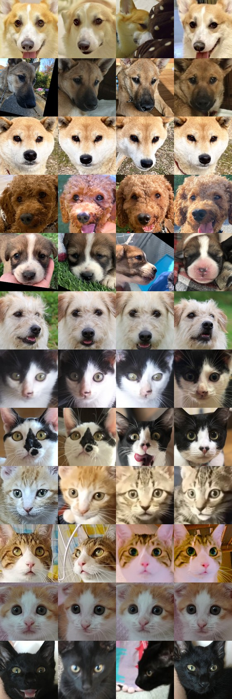
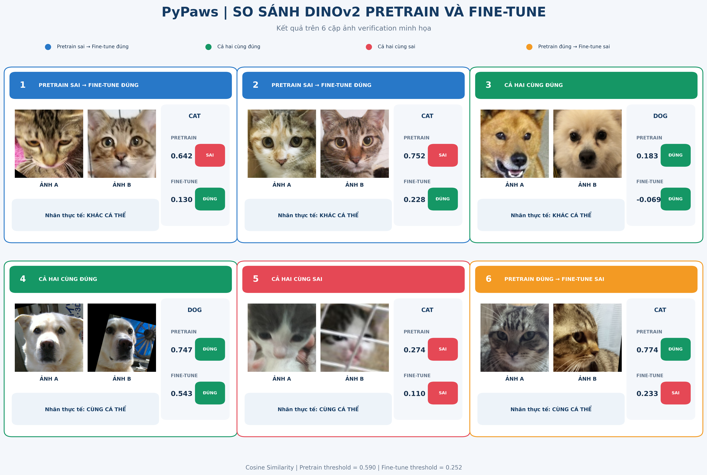
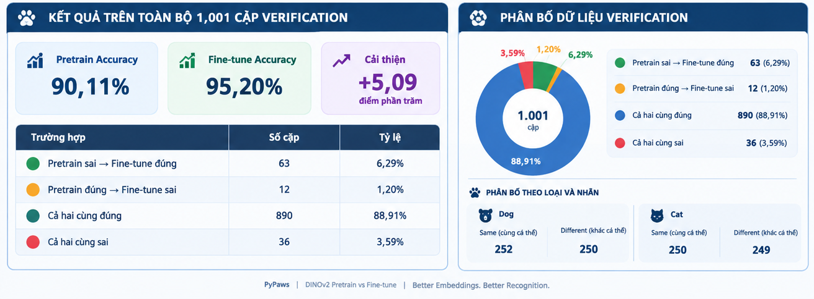
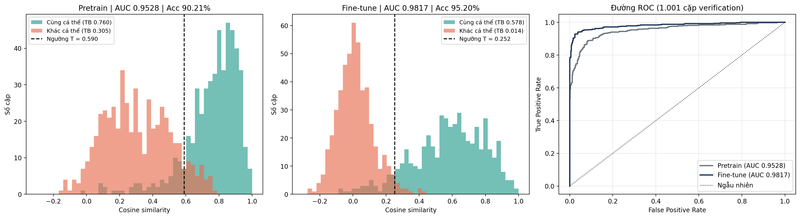
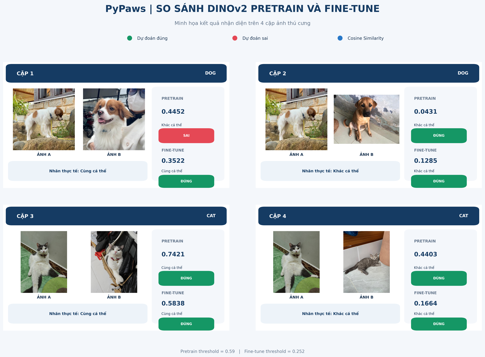

# Fine-tune DINOv2 nhận diện cá thể chó mèo (PetFace)

Fine-tune **DINOv2 ViT-S/14** bằng **ArcFace** để so khớp khuôn mặt thú cưng: hai ảnh có cùng một con hay không.
Đầu ra của mô hình là vector 512 chiều (L2-normalize), so sánh bằng cosine similarity.
## Training Dataset Preview

Ảnh minh họa dữ liệu chó mèo dùng trong quá trình phát triển
và đánh giá mô hình nhận diện cá thể.



Lưu ý: Bộ dữ liệu huấn luyện đầy đủ không được lưu trong repository.
### Verification Dataset Preview

Ảnh minh họa các cặp chó mèo được sử dụng để đánh giá khả năng nhận diện cá thể của mô hình DINOv2 Pretrain và Fine-tune. Hình ảnh thể hiện nhãn thực tế, cosine similarity và kết quả dự đoán của từng mô hình.



## Verification Performance

Kết quả đánh giá mô hình DINOv2 Pretrain và Fine-tune trên 1.001 cặp ảnh verification.


### Fine-tune Results
Kết quả huấn luyện và đánh giá mô hình DINOv2 Fine-tune trên tập PetFace.



### Verification Test
Minh họa kết quả kiểm thử khả năng nhận diện hai ảnh cùng hoặc khác cá thể thực tế.


## Kết quả

Đánh giá trên **1.001 cặp verification** (502 cặp cùng cá thể, 499 cặp khác cá thể; 502 cặp chó, 499 cặp mèo).
Hai mô hình dùng cùng pipeline (resize 224, flip TTA). ID của tập train và verification không trùng nhau.

| Chỉ số | Pretrain | Fine-tune | Thay đổi |
|---|---|---|---|
| ROC-AUC | 0.9528 | **0.9817** | +0.029 |
| Accuracy | 90.21% | **95.20%** | +4.99 điểm % |
| EER (thấp hơn là tốt) | 10.59% | **5.59%** | giảm gần một nửa |
| TPR @ FPR = 1% | 62.95% | **86.06%** | +23.1 điểm % |
| Điểm cùng cá thể / khác cá thể (TB) | 0.760 / 0.305 | 0.578 / 0.014 | margin 0.455 → 0.564 |

| Loài | AUC pretrain | AUC fine-tune |
|---|---|---|
| Chó (502 cặp) | 0.9732 | 0.9865 |
| Mèo (499 cặp) | 0.9321 | 0.9765 |

**Lưu ý**
- Chạy một lần, một seed. Chênh lệch nhỏ giữa các epoch cuối là nhiễu; mức tăng +0.029 AUC lớn hơn nhiễu.
- Ngưỡng và Accuracy được chọn trên chính tập verification nên hơi lạc quan. AUC và EER ít bị ảnh hưởng hơn.
- Mỗi loài chỉ khoảng 500 cặp, nên số liệu theo loài (đặc biệt TPR@FPR=1%) dao động khá nhiều.
- Điểm cosine của mô hình fine-tune co lại (khác cá thể gần 0), nên **không dùng ngưỡng 0.59 của pretrain** cho mô hình mới.

## Dữ liệu

Tập train lấy mẫu **theo cá thể** từ PetFace đầy đủ, vì metric learning cần nhiều ảnh của cùng một con.

| | Dataset gốc (chó + mèo) | Dùng trong đồ án |
|---|---|---|
| Ảnh train | 573.381 (168.348 chó, 405.033 mèo) | **10.000** (5.000 chó + 5.000 mèo) |
| Cá thể train | 160.347 | **2.500** (1.250 chó + 1.250 mèo), 4 ảnh/cá thể |
| Cặp verification | 103.532 | **1.001** |

## Cấu trúc thư mục

| File | Vai trò |
|---|---|
| `common.py` | Mô hình, ArcFace, transform, hàm embed và đánh giá dùng chung |
| `build_train_subset.py` | Tạo tập train 10.000 ảnh từ `dog.tar.gz`, `cat.tar.gz`|
| `train.py` | Fine-tune, in baseline pretrain và chỉ số từng epoch, lưu checkpoint + log JSON |
| `evaluate.py` | So sánh pretrain và fine-tune, xuất bảng, AUC theo loài, histogram và ROC |
| `embedder.py` | **Dành cho backend:** nạp checkpoint và tạo embedding, tự đủ, không phụ thuộc file khác |
| `requirements.txt` | Thư viện cần cài |

Checkpoint (`*.pt`) và dữ liệu **không** nằm trong repo (đã chặn bằng `.gitignore`), chia sẻ qua Google Drive.

## Chạy lại trên Google Colab

```bash
pip install -r requirements.txt
```

**Bước 1. Tạo tập train**

```bash
python build_train_subset.py --root "/content/drive/MyDrive/PETFACE dataset" \
    --dog-tar <đường dẫn dog.tar.gz> --cat-tar <đường dẫn cat.tar.gz> \
    --out /content/petface_train --zip
```

Nếu đã có `petface_train_10k_byID.zip` trên Drive thì giải nén lại, đổi tên ảnh về dạng phẳng `dog_000123_00.png`
và tạo lại `train_subset.csv` (cột `filename, pid, animal, fp`) thay vì quét tar lần nữa.

**Bước 2. Giải nén ảnh verification** (`petface_veri_1000_images.zip`) vào `/content/petface`.

**Bước 3. Fine-tune**:

```bash
python train.py --root "/content/drive/MyDrive/PETFACE dataset" \
    --train-csv /content/petface_train/train_subset.csv \
    --veri-dir /content/petface \
    --out "/content/drive/MyDrive/PETFACE dataset/dinov2_petface_ft.pt"
```

Cấu hình đã dùng: 8 epoch, batch 64, mở 4 block cuối, LR backbone 1e-5, LR head 1e-3, ArcFace scale 30 margin 0.3, seed 42.

**Bước 4. Đánh giá và vẽ hình:**

```bash
python evaluate.py --root "/content/drive/MyDrive/PETFACE dataset" \
    --veri-dir /content/petface \
    --ckpt "/content/drive/MyDrive/PETFACE dataset/dinov2_petface_ft.pt" --out-dir /content/results
```

## Bàn giao cho backend (Quỳnh)

1. Tải checkpoint `dinov2_petface_ft.pt` từ Google Drive: https://drive.google.com/file/d/1r8i22GunT8C8WrIwomVyu8Iogik4pqqa/view?usp=drive_link
2. Copy `embedder.py` vào backend, cài `torch`, `torchvision`, `pillow`, `numpy`.
3. Dùng:

```python
from embedder import PetFaceEmbedder

emb = PetFaceEmbedder('dinov2_petface_ft.pt')   # tải một lần khi khởi động server
vec = emb.embed('anh_tin_dang.jpg')             # numpy float32 (512,), đã normalize
score = emb.similarity(vec, other_vec)          # cosine similarity
```

Gợi ý tích hợp (ghép tin LOST/FOUND):
- Tính embedding **một lần khi đăng tin**, lưu vector 512 chiều cùng tin. Khi có tin mới, so với các tin loại đối lập
  bằng cosine và lấy top-k làm gợi ý (`emb.top_k`). Không tính lại embedding mỗi lần so khớp.
- Dùng **điểm số để xếp hạng** ứng viên, để người dùng xác nhận. Ngưỡng 0.252 (`is_same`) chỉ mang tính tham khảo.
- Mô hình học trên ảnh **mặt thú cưng đã crop** (dạng PetFace). Ảnh người dùng chụp cả con vật nên crop mặt trước
  khi embed, nếu không độ chính xác sẽ thấp hơn các số ở trên. Đây là điểm cần kiểm thử với ảnh thật của hệ thống.
- Lần chạy đầu `torch.hub` tải code DINOv2 từ GitHub và cache lại.

