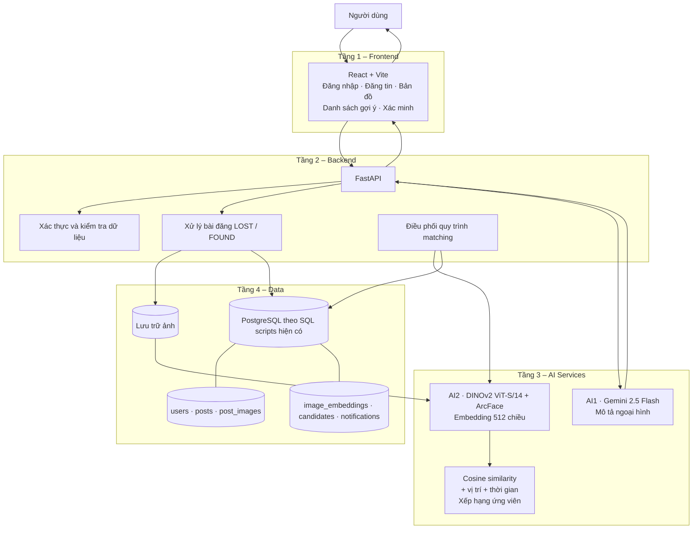
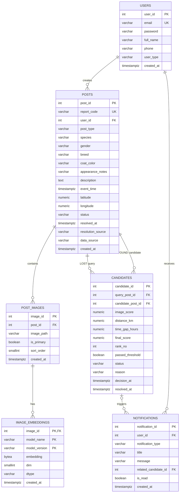

# PyPaws – Kiến trúc hệ thống và thiết kế cơ sở dữ liệu

> Tài liệu bổ sung phục vụ báo cáo và slide. Nội dung được đối chiếu với mã nguồn trong repository tại thời điểm cập nhật.
>
> **Lưu ý quan trọng về môi trường dữ liệu:** các file `db/schema (3).sql` và `db/queries (3).sql` hiện dùng cú pháp **PostgreSQL** (ví dụ `timestamptz`, `bytea`, `plpgsql`, `pg_notify`), không phải SQL Server. Vì vậy, không được mô tả cấu hình hiện tại là SQL Server nếu nhóm chưa chuyển đổi schema và câu lệnh SQL tương ứng.

## 1. Kiến trúc tổng thể

PyPaws được mô tả theo 4 tầng logic:

1. **Tầng giao diện – React + Vite:** người dùng đăng nhập, đăng tin LOST/FOUND, tải ảnh, xem danh sách và xác minh gợi ý.
2. **Tầng dịch vụ – FastAPI:** tiếp nhận request, kiểm tra dữ liệu, gọi AI1/AI2, xử lý nghiệp vụ và giao tiếp với cơ sở dữ liệu.
3. **Tầng trí tuệ nhân tạo – AI Services:**
   - AI1: Gemini 2.5 Flash qua OpenRouter tạo mô tả ngoại hình từ ảnh. Người dùng được chỉnh sửa trước khi lưu.
   - AI2: DINOv2 ViT-S/14 fine-tune ArcFace tạo embedding 512 chiều; cosine similarity được dùng để đánh giá độ tương đồng hình ảnh. Điểm ảnh được kết hợp với thông tin vị trí/thời gian để xếp hạng ứng viên.
4. **Tầng dữ liệu – Database và lưu trữ ảnh:** lưu người dùng, bài đăng, ảnh, embedding, ứng viên và thông báo.

### Sơ đồ kiến trúc logic

**Luồng đăng tin và AI1:** người dùng tải ảnh → Frontend gửi ảnh đến `POST /api/ai/describe-pet` → FastAPI gọi Gemini 2.5 Flash qua OpenRouter → trả mô tả tiếng Việt → người dùng chỉnh sửa → API đăng tin hiện có lưu nội dung.

**Luồng AI2 LOST/FOUND (luồng tích hợp mục tiêu):** bài đăng và ảnh được lưu → backend lấy ảnh cần embedding → DINOv2 tạo vector 512 chiều → lưu embedding theo ảnh và phiên bản mô hình → khi có bài mới, lấy các bài ACTIVE đối lập loại (LOST so với FOUND), cùng loài → tính cosine similarity, khoảng cách và chênh lệch thời gian → xếp hạng → lưu candidates → frontend hiển thị để người dùng xác minh.

> **Trạng thái triển khai cần trình bày trung thực:** repository có module inference `ai/dinov2_petface/embedder.py` và các hàm SQL phục vụ embedding/matching. README AI2 hướng dẫn backend sử dụng embedder, nhưng tài liệu đó chưa chứng minh đã có FastAPI router AI2 hoàn chỉnh được đăng ký và chạy trong ứng dụng. Chỉ ghi “đã tích hợp end-to-end” sau khi kiểm thử được request thực tế từ frontend qua FastAPI, mô hình và database.

## 2. Thiết kế cơ sở dữ liệu

Các bảng dưới đây được tổng hợp từ `db/schema (3).sql`.

### 2.1. Sơ đồ ERD

### 2.2. Mô tả các bảng

| Bảng | Khóa chính | Chức năng và trường quan trọng |
|---|---|---|
| `users` | `user_id` | Tài khoản người dùng; `email` duy nhất, `password` lưu password hash, `user_type` phân loại tài khoản. |
| `posts` | `post_id` | Bài LOST/FOUND; `report_code` là mã bài duy nhất; `user_id` là người đăng; `post_type`, `species`, `event_time`, `latitude`, `longitude`, `status` là các trường phục vụ tìm kiếm. |
| `post_images` | `image_id` | Ảnh của bài đăng; `post_id` liên kết bài đăng; `image_path` lưu đường dẫn ảnh; `is_primary` đánh dấu ảnh bìa. |
| `image_embeddings` | `image_id + model_name + model_version` | Vector đặc trưng ảnh do DINOv2 tạo; `embedding` lưu float32 dạng bytes; `dim` dự kiến 512; `model_version` giúp phân biệt phiên bản mô hình. |
| `candidates` | `candidate_id` | Kết quả gợi ý theo cặp LOST–FOUND; lưu `image_score`, `distance_km`, `time_gap_hours`, `final_score`, `rank_no`, `passed_threshold` và trạng thái xác minh. |
| `notifications` | `notification_id` | Thông báo cho người dùng; có thể liên kết với `candidate_id`, theo dõi trạng thái đã đọc. |

### 2.3. Quy tắc nghiệp vụ và trạng thái

**Trạng thái bài đăng (`posts.status`):**

- `ACTIVE`: bài đang hoạt động và có thể tham gia matching.
- `RESOLVED`: bài đã được giải quyết.
- `CANCELLED`: người đăng chủ động hủy bài.

**Trạng thái gợi ý (`candidates.status`):**

- `PENDING`: AI đã đề xuất, chờ người dùng xử lý.
- `REJECTED`: người dùng xác nhận không phải thú cưng cần tìm.
- `CONTACTED`: người đăng bài LOST đã chọn liên hệ.
- `RESOLVED`: cặp bài được xác nhận đã giúp tìm lại thú cưng.
- `CANCELLED`: gợi ý không còn cần thiết.

**Quy tắc quan trọng:**

- `query_post_id` luôn trỏ đến bài LOST.
- `candidate_post_id` luôn trỏ đến bài FOUND.
- Hai bài phải cùng loài và không được là cùng một bài.
- Mỗi cặp LOST–FOUND chỉ có một dòng candidate.
- Chỉ các bài `ACTIVE` thuộc hai loại đối lập và cùng loài được đưa vào pool matching.
- Điểm matching là điểm xếp hạng/gợi ý, không phải xác suất chắc chắn hai ảnh là cùng một cá thể. Người dùng vẫn phải xác minh.

### 2.4. Các hàm dữ liệu hỗ trợ AI2

Trong `db/queries (3).sql` đã có các hàm phục vụ quy trình:

| Hàm | Vai trò |
|---|---|
| `get_images_needing_embedding` | Lấy ảnh chưa có embedding theo model và version. |
| `save_image_embedding` | Lưu hoặc cập nhật embedding. |
| `get_post_match_context` | Lấy thông tin bài và embedding ảnh bìa. |
| `get_match_pool` / `get_search_pool` | Lấy các bài đối lập loại, cùng loài, đang ACTIVE và có embedding. |
| `save_candidate` | Lưu hoặc cập nhật điểm gợi ý cho một cặp LOST–FOUND. |
| `refresh_candidate_ranks` | Cập nhật thứ hạng ứng viên theo final score. |
| `get_candidates_for_post` | Lấy danh sách gợi ý cho bài LOST. |
| `contact_candidate`, `reject_candidate`, `resolve_lost_post` | Xử lý quyết định của người dùng và kết quả xác minh. |

## 3. Các nội dung cần hoàn thiện trước khi chốt báo cáo

1. **Thống nhất hệ quản trị CSDL:** xác nhận nhóm dùng PostgreSQL hay SQL Server. Nếu dùng SQL Server, phải chuyển đổi schema, stored functions, kiểu dữ liệu và truy vấn; không chỉ đổi tên trong báo cáo.
2. **Hoàn thiện tích hợp AI2:** tạo/kiểm tra FastAPI router, nạp checkpoint một lần khi khởi động, nhận ảnh, tạo embedding, đọc/ghi database và trả kết quả matching cho frontend.
3. **Kiểm thử ảnh thực tế:** README AI2 ghi rõ mô hình được huấn luyện trên ảnh mặt thú cưng đã crop; ảnh người dùng có thể chụp toàn thân nên cần bổ sung bước detect/crop mặt hoặc đánh giá giới hạn này.
4. **Hiệu chỉnh ngưỡng:** ngưỡng 0.252 được chọn trên 1.001 cặp verification PetFace; không mặc định xem đây là ngưỡng tối ưu cho ảnh người dùng thực tế. Ưu tiên dùng cosine để xếp hạng và cho người dùng xác minh.
5. **Bổ sung minh chứng tích hợp:** ảnh chụp Swagger/API, log backend, dữ liệu embedding được ghi vào DB, kết quả candidates và giao diện hiển thị danh sách gợi ý.
6. **Bổ sung ERD và kiến trúc vào báo cáo/slide:** có thể dùng hai sơ đồ Mermaid trong tài liệu này để xuất thành hình.

## 4. Phạm vi tài liệu

ERD phản ánh các bảng đang được định nghĩa trong file schema hiện có. Các bảng nhận nuôi xuất hiện trong lệnh DROP nhưng không được tạo trong phần schema đã kiểm tra, vì vậy không đưa vào ERD này. Nếu chức năng nhận nuôi đã có schema ở file khác, cần cập nhật ERD theo đúng file triển khai đó.
